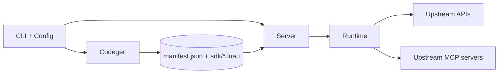
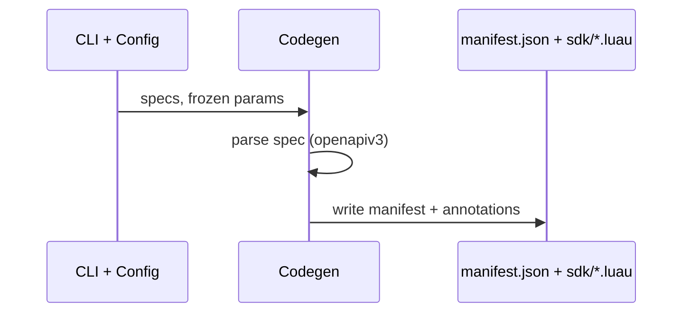
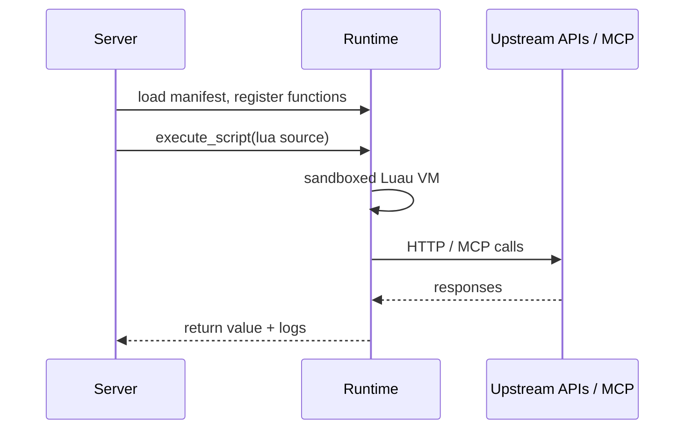

# Codemap

## Overview

toolscript turns OpenAPI specs and upstream MCP servers into a scriptable MCP server: it generates a strongly-typed Luau SDK from specs, then serves an MCP tool (`execute_script`) that runs sandboxed Luau scripts chaining SDK calls against the upstream APIs. Built in Rust (edition 2024), `openapiv3` for spec parsing, `mlua`/Luau for the sandbox, `rmcp` for MCP serving.

### Key Flows

Generate pipeline: specs are loaded and parsed into a `Manifest`, then annotation files are written next to it.

Serve pipeline: the MCP server loads the manifest, registers SDK functions and upstream MCP tools in the Luau registry, and executes scripts against the sandbox.

## Modules

### CLI + Config

Argument parsing, TOML config loading/merging, and process orchestration for the `generate`, `serve`, and `run` subcommands. `main.rs` wires codegen output into server startup and owns the auth/credential resolution order (CLI → config → `_meta.auth`).

**Responsibilities:** clap definitions, spec/auth/MCP argument parsing, config file merge semantics, credential resolver setup, generate/serve wiring

**Dependencies:** Codegen (runs the pipeline), Server (starts the MCP server), Runtime (credentials, executor config)

**Files:**
- `src/main.rs`
- `src/cli.rs`
- `src/config.rs`

### Codegen

Turns OpenAPI specs and upstream MCP tool schemas into the versioned manifest and Luau annotation files. `parser.rs` walks `openapiv3` types (paths, parameters, schemas, auth schemes, servers); `manifest.rs` defines the serializable intermediate representation consumed by everything downstream; `luau_types.rs` converts raw JSON Schema (from upstream MCP tools) into manifest types; `annotations.rs` renders Luau type annotations and docs; `generate.rs` runs the pipeline and writes output.

**Responsibilities:** spec loading (file/URL, YAML/JSON), OpenAPI extraction to manifest, JSON Schema to manifest types, Luau annotation rendering, manifest serialization, frozen-parameter application

**Dependencies:** none (leaf producer of the manifest artifact; depends only on external crates `openapiv3`, `serde`, `serde_yaml`)

**Files:**
- `src/codegen/**`
- `testdata/**`

### Runtime

Executes Luau scripts in a sandboxed VM and fulfills SDK calls. `registry.rs` maps manifest functions and MCP tools to callable Luau functions (parameter validation, path/query/header wiring, enum/format checks via `validate.rs`); `http.rs` performs authenticated upstream HTTP; `executor.rs` owns the VM lifecycle and limits; `sandbox.rs`, `io.rs` provide the sandboxed environment and file I/O; `credentials.rs` resolves API credentials (including command-based sources with stale-while-revalidate caching); `mcp_client.rs` manages upstream MCP connections.

**Responsibilities:** Luau execution and limits, SDK function registration, parameter validation, upstream HTTP with auth injection, sandboxed file I/O, credential resolution and caching, upstream MCP client sessions

**Dependencies:** Codegen (consumes manifest types), Server (invoked through it)

**Files:**
- `src/runtime/**`

### Server

The MCP server surface: tool implementations (`execute_script`, `list_apis`, `list_functions`, `get_function_docs`, `search_docs`), browsable `sdk://` resources, built-in helper docs, and downstream JWT authentication for HTTP/SSE transport.

**Responsibilities:** MCP tool handlers, resource URI routing, server instructions and info, downstream auth

**Dependencies:** Runtime (executes scripts), Codegen (reads manifest for docs/resources)

**Files:**
- `src/server/**`

### Integration Tests

End-to-end coverage across codegen, serving, auth, and upstream MCP.

**Responsibilities:** cross-module behavioral tests

**Dependencies:** all modules

**Files:**
- `tests/**`
- `e2e/**`
